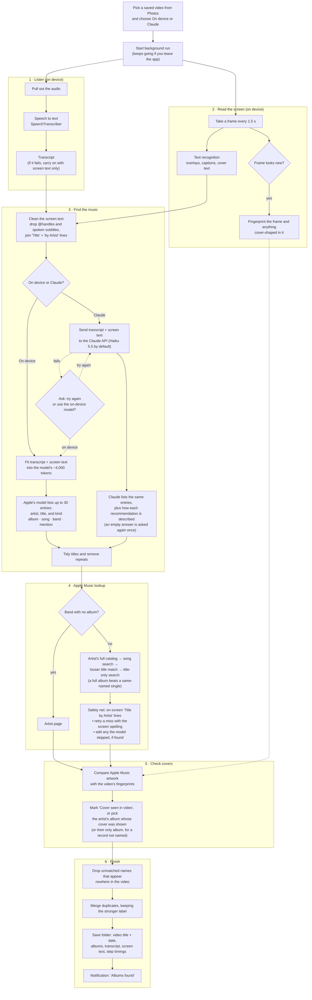

# Album Finder

An iPhone app that finds the music recommended in a TikTok or Instagram video and links each album in Apple Music.

Save the video to Photos, pick it in the app, and choose who finds the music: Apple's on-device model, or Claude through the Claude API. Each video becomes a folder named after it and the date, with every recommendation labelled (album, song or band) and the albums only mentioned in passing listed separately. With Claude, each recommendation also gets a short description of how the person in the video talks about it.

## How it works

## Privacy

The video and its audio never leave the iPhone. The Apple Music lookups send album and artist names to Apple's public iTunes Search API. With Claude chosen, the video's transcript and screen text are also sent to Anthropic.

## Requirements

- An iPhone with Apple Intelligence on iOS 26 or later, for the on-device model.
- For Claude: an API key from [console.anthropic.com](https://console.anthropic.com), entered in the app's Settings. API use is billed by Anthropic, separately from a Claude subscription.
- Xcode to build and install the app. With a free Apple developer account the app has to be reinstalled every 7 days.
